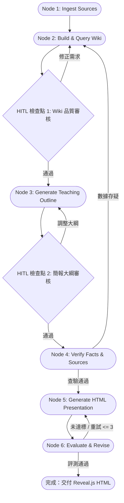

# AGENTS.md — SiC Market LLM Wiki & Presentation System Specification

本文件定義「SiC 功率半導體市場 LLM Wiki 與教學簡報系統」之多 Agent 協同規範、角色職責、狀態流轉與防錯規則。

---

## 1. 核心設計原則

1. **Sources are Sacred（原始來源至上）**：
   所有市場規模、CAGR、市佔率、技術參數皆必須具備明確來源出處（Source ID 與章節）。嚴禁虛構、推測未經證實的數據。
2. **Explicit Time Anchoring（嚴格時間戳記）**：
   嚴格區分 **Historical Data（歷史數據）**、**Forecast（機構預測）** 與 **Current Status（產業現況）**。基準時間為 2026 年，2024 年以前的預測不得直接表述為已實現的事實。
3. **Atomic & Interconnected Knowledge（原子化與網絡化知識）**：
   遵循 Andrej Karpathy 的 LLM Wiki 概念，每篇 Wiki 筆記聚焦單一主題，使用 YAML Frontmatter 記錄元資料，並使用 `[[wikilinks]]` 互相串連。
4. **Human-in-the-Loop（關鍵節點人工審核）**：
   在 **Wiki 建立完成（Node 2 結束）** 及 **簡報大綱完成（Node 3 結束）** 時，必須暫停並由人類審核確認後，方可進入下一階段。
5. **Bounded Auto-Retry（有界自動修正）**：
   每個節點遭遇驗證失敗時，最多執行 3 次自動修正重試；若仍未達標或遇到重大資料缺漏，必須立即中斷並回報人類，不得降級瞎猜。

---

## 2. 六階段 Graph 工作流程規範

---

### Node 1: Ingest Sources（原始資料收錄與驗證）
- **Input**: 外部原始公開文獻、網址、年報或論文（共 5 篇）。
- **Task**: 
  - 查驗文獻來源之真實性、可取得性（URL、DOI、發布機構）。
  - 將原始內容標準化存入 `data/raw/`。
  - 建立 `data/raw/metadata.json`，登錄 Source ID、標題、發布者、日期、存取網址、公開範圍與對應主題。
- **Output**: 
  - `data/raw/source_*.md` 原始存證檔。
  - `data/raw/metadata.json`。
- **Validation Criteria**:
  - 5 篇文獻全數可溯源，無失效連結。
  - 涵蓋 SiC 五大核心主題。
  - 明確界定公開範圍，付費文獻僅限公開摘要。
- **Failure / Retry Condition**: 
  - 若 URL 無法讀取或 DOI 錯誤，觸發重試（重新檢索真實 URL/DOI，最多 3 次）；若仍無效則回報人類更換來源。

---

### Node 2: Build and Query Wiki（知識庫建置與關聯檢索）
- **Input**: `data/raw/` 原始檔案與 `metadata.json`。
- **Task**:
  - 將原始資料萃取、解構為原子化概念筆記，存入 `wiki/` 各子目錄（`concepts/`, `market/`, `supply-chain/`, `entities/`, `outlook/`）。
  - 為每篇筆記加入 YAML Frontmatter（title, category, tags, sources, last_updated）。
  - 建立雙向內部連結（`[[concept-name]]`）。
  - 編寫 `wiki/INDEX.md` 提供完整導航樹。
- **Output**:
  - `wiki/` 結構化 Markdown 檔案。
  - `wiki/INDEX.md`。
- **Validation Criteria**:
  - 所有具體數據（金額、百分比、尺寸）皆有標註 Source ID。
  - 無斷鏈（Broken `[[links]]`）或孤島頁面（Orphan Pages）。
  - 完整覆蓋 SiC 五大主題。
- **Failure / Retry Condition**:
  - 發現斷鏈或數據缺漏出處時自動補正重試（最多 3 次）。
- **Human-in-the-Loop Checkpoint 1**:
  - 向使用者提交 Wiki 檢查報告（包含頁面清單、來源對應、斷鏈檢測結果），經確認後方可繼續。

---

### Node 3: Generate Teaching Outline（初學者教學大綱生成）
- **Input**: `wiki/` 知識庫內容與主題架構。
- **Task**:
  - 為「半導體初學者」設計約 8 頁的 Reveal.js 簡報教學大綱。
  - 由淺入深編排：
    1. 封面與導言（為什麼需要 SiC？）
    2. 什麼是 SiC？寬能隙物理與矽（Si）的根本差異
    3. 核心優勢：高壓、高頻、高溫耐受力（白話比喻）
    4. 關鍵應用動能：電動車 800V 平台與再生能源
    5. 市場現況與規模：歷史數據與未來成長預測
    6. 產業鏈全貌：長晶、磊晶、晶圓製造與封裝模組
    7. 競爭格局與擴產：國際五大巨頭與 8 吋晶圓升級潮
    8. 未來展望與挑戰：良率瓶頸、成本與產能競賽
  - 每頁需標註對應之 Wiki 頁面與來源。
- **Output**: 簡報大綱與講者說明稿結構草案。
- **Validation Criteria**:
  - 頁數約 8 頁，脈絡邏輯完整，無晦澀未解之術語。
  - 每頁皆可追溯至 Wiki 知識庫。
- **Human-in-the-Loop Checkpoint 2**:
  - 由人類審核大綱邏輯、教學難易度與各頁主題分配。

---

### Node 4: Verify Facts and Sources（事實與數據交叉核查）
- **Input**: 審核通過的大綱與簡報文字素材、`data/raw/`、`wiki/`。
- **Task**:
  - 逐項核對簡報內所有技術數據、市場規模、CAGR、市佔率與晶圓規格。
  - 嚴格檢查年份標籤（歷史數據 vs 預測數據）。
  - 檢查市場定義（元件 Device vs 基板 Substrate 是否混淆）。
- **Output**: `verification_report.md` 核查對照表。
- **Validation Criteria**:
  - 數據 100% 來自 Wiki 與原始文獻，零幻覺、零編造。
  - 單位與年份完全精確標示。
- **Failure / Retry Condition**:
  - 若發現數據未定義或年份矛盾，退回 Node 2 或 Node 3 修正（最多 3 次）。

---

### Node 5: Generate HTML Presentation（Reveal.js 簡報生成）
- **Input**: 核查無誤之簡報內容、視覺佈局規劃。
- **Task**:
  - 撰寫 `presentation/index.html`。
  - 整合 Reveal.js（透過官方 CDN 載入，並在頁面與文件註明需連網環境）。
  - 套用現代簡潔半導體科技風格（CSS 自訂主題、高對比度卡片排版、數據重點突顯）。
  - 為每張投影片加入 `<aside class="notes">` 演講者備忘稿，協助講師口頭解說。
  - 建立底部或彈窗引用標註，提供點擊至 Wiki 或 Source 的對應出處。
- **Output**: `presentation/index.html`。
- **Validation Criteria**:
  - 瀏覽器可正常載入，投影片切換流暢。
  - 支援鍵盤導航（方向鍵、空格鍵）、全螢幕（F 鍵）、演講者模式（S 鍵）。
  - 排版無溢出、圖表字體清晰。
- **Failure / Retry Condition**:
  - 若語法錯誤或排版毀損，進行 HTML/CSS 修正（最多 3 次）。

---

### Node 6: Evaluate and Revise（綜合品質審查與修正）
- **Input**: `presentation/index.html`、初學者評估指標。
- **Task**:
  - 從「初學者可理解度」、「視覺資訊層次」、「內容真實度」三大維度評分。
  - 執行自動化檔案與排版檢查。
- **Output**: 最終驗收結論與更新 `workflow/execution_log.md`。
- **Validation Criteria**:
  - 8 頁內容清晰可讀，完全無半導體背景讀者亦能掌握核心觀念。
- **Failure / Retry Condition**:
  - 未達標則提出具體修改建議，退回 Node 5 調整（最多 3 次）。

---

## 3. 執行紀錄與反思規範

所有節點執行時，必須即時於 `workflow/execution_log.md` 忠實記錄：
1. 節點名稱與執行時間。
2. 實際輸入與輸出檔案。
3. 驗證結果（Pass / Fail）。
4. 遇到的真實問題（如 DOI 錯誤、網址重導向、概念斷鏈）。
5. 採取的修正措施與重試次數。
6. 對後續流程的前置化建議（Lessons Learned）。

> 嚴禁預先編造未執行節點之執行成功紀錄。未執行節點狀態必須明確標示為 `Pending`。
