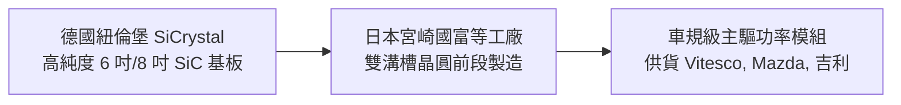

# 羅姆半導體：垂直整合雙溝槽技術巨頭（ROHM）

**羅姆半導體（ROHM Semiconductor）**，總部位於日本京都市，是全球歷史悠久的微電子 IDM 巨頭，在碳化矽（SiC）領域位居全球前五大供應商行列（出處：`SRC-02`）。

---

## 1. 市場地位與市佔格局（Top 5 Global Supplier）

- **2023 年全球前五大**：根據 TrendForce 統計（出處：`SRC-02`），ROHM 與 ST、onsemi、Infineon、Wolfspeed 合計囊括全球 **91.9%** 的 SiC 功率元件市場。
- **車用生態系綁定**：ROHM 與德國大陸集團旗下 Vitesco Technologies、日本馬自達（Mazda）、中國吉利汽車（Geely）等全球車廠及 Tier-1 建立了深厚的戰略供貨同盟。

---

## 2. 核心技術：原創雙溝槽架構（Double Trench Structure）

- **架構突破**：
  - 傳統平面 MOSFET 存在 JFET 區域電阻，而一般溝槽 MOSFET 易在底角產生過高電場。
  - ROHM 首創 **雙溝槽（Double Trench）結構**：在源極溝槽與閘極溝槽兩側均施加保護，有效消除了閘極氧化層的電場集中風險，同時大幅降低比導通電阻（$R_{DS(on)} \cdot A$）達 50%（出處：`SRC-01`）。

---

## 3. 垂直整合與 8 吋擴產佈局

- **德國子企 SiCrystal**：ROHM 早年全資收購德國知名長晶廠 SiCrystal，掌握長晶與晶圓拋光自主權，建立起高自給率之垂直整合體系。
- **日本宮崎國富工廠擴產**：收購原 Solar Frontier 工廠，投資數千億日圓改建為專用 8 吋 SiC 基板與前段晶圓生產基地（出處：`SRC-04`）。

---

## 4. 關聯知識頁面
- 溝槽電晶體技術：[[device-structures-mosfet]]
- 全球市佔與排名：[[market-size-and-growth]]
- 8 吋晶圓升級浪潮：[[8-inch-wafer-transition]]
- 競爭對手：[[stmicroelectronics]], [[infineon]], [[onsemi]], [[wolfspeed]]
