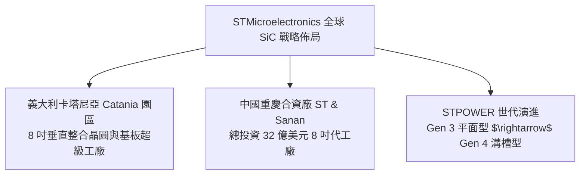

# 意法半導體：全球 SiC 功率元件龍頭（STMicroelectronics）

**意法半導體（STMicroelectronics, 簡稱 ST）** 是歐洲最大的半導體整合元件製造商（IDM）之一，總部位於瑞士日內瓦，在碳化矽（SiC）功率半導體領域長年雄踞全球第一寶座。

---

## 1. 市場地位與市佔數據（Market Standing）

根據 TrendForce 於 2024 年 6 月發布之研調數據（出處：`SRC-02`）：
- **2023 年全球市佔率**：**32.6%**，穩居全球龍頭第一名。
- **商業化先驅**：早在 2018 年，ST 便率先與 Tesla 達成深度合作，將 SiC MOSFET 模組成功導入 Model 3 主驅牽引逆變器，開創全球車用 SiC 大規模商業化量產之歷史先河。
- **車用主導性**：ST 的 SiC 營收絕大部分來自電動車（EV）領域，是包括 Tesla、Hyundai、Renault 等全球一線車廠之核心功率元件供應商。

---

## 2. 全球製造佈局與 8 吋垂直整合策略

為鞏固成本優勢並降低對外部晶圓基板的依賴，ST 展開了激進的垂直整合與 8 吋升級戰略（出處：`SRC-02`, `SRC-04`）：

### 2.1 義大利卡塔尼亞超級園區（Catania Integrated Campus）
- ST 投入數十億歐元在義大利西西里島卡塔尼亞打造全球領先的全製程垂直整合基地。
- 涵蓋從晶錠長晶、晶圓拋光基板到 8 吋前段晶圓製造的一條龍自製能力，顯著提升材料自給率。

### 2.2 與中國三安光電（Sanan）重慶合資專案
- 總投資高達 **32 億美元**，共同興建一座專用 8 吋 SiC 晶圓代工廠。
- **分工模式**：三安光電獨資設立 8 吋基板製造廠以提供材料支援，合資廠採用 ST 專有製程技術生產元件，專門鎖定中國龐大之本土電動車市場需求。

---

## 3. 競爭優勢與未來挑戰
- **優勢**：擁有全球最龐大的車規量產出貨數據（累積數百萬輛車隊運行驗證）、極高的規模經濟與品牌溢價。
- **挑戰**：面對 [[onsemi]] 在第二名的步步緊逼，以及亞洲本土基板廠低價擴產對現有供應鏈價格體系的衝擊。

---

## 4. 關聯知識頁面
- 全球市佔格局：[[market-size-and-growth]]
- 車用逆變器深度分析：[[ev-and-automotive-demand]]
- 8 吋廠建置追蹤：[[8-inch-wafer-transition]]
- 主要競爭對手：[[onsemi]], [[infineon]], [[wolfspeed]]
