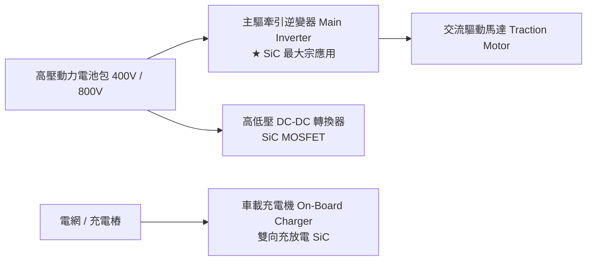

# 電動車與車載應用市場需求（EV & Automotive Demand）

在所有功率半導體應用中，**電動車（Electric Vehicles, EV/BEV/PHEV）** 是推進碳化矽（SiC）商業化與市場規模擴張的決定性引擎。

根據 Yole Group 統計（出處：`SRC-03`），車用領域在整體 Power SiC 元件市場中佔據 **超過 70%** 的壓倒性市場份額。

---

## 1. 電動車三大核心應用子系統

### 1.1 主驅牽引逆變器（Main Traction Inverter）
- **功能**：將高壓電池的直流電（DC）逆變為控制三相驅動馬達的交流電（AC），掌控整車動力輸出與能量回收。
- **痛點與 SiC 效益**：
  - 在典型市區行駛（頻繁啟停與輕中負載）工況下，SiC MOSFET 因無雙極門檻壓降，導通與開關損耗顯著低於傳統矽基 IGBT（出處：`SRC-01`）。
  - **續航與電池權衡（條件評估）**：根據學術文獻與車輛工程模擬（出處：`SRC-01`），在標準測試循環（如 WLTP）下，SiC 逆變器損耗降低推估可為整車帶來約 **5%～10% 的續航里程增益**；車廠亦可反向評估在維持相同續航目標下，適度減少電池包容量以抵銷晶片溢價。

### 1.2 車載充電機（OBC）與高低壓 DC-DC 轉換器
- **功能**：負責交流慢充至動力電池的交直流轉換，以及將動力高壓電轉換為車內 12V/48V 輔助電氣系統。
- **痛點與 SiC 效益**：
  - 支援雙向充放電（V2G / V2L）。
  - 高開關頻率大幅縮減被動電感與散熱片體積，使 OBC 功率密度突破 $3\text{ kW/L}$，減輕整車前軸載重。

---

## 2. 800V 高壓電氣架構升級浪潮

傳統電動車多採用 400V 電氣系統，在充電功率突破 250kW～350kW 時，電流高達數百安培，造成電纜線束粗重與嚴重發熱。

轉向 **800V 電壓平台** 成為產業共識：
- **物理定律優勢**：在相同充電功率下，電壓翻倍使得電流減半，銅線焦耳熱損耗（$P = I^2 R$）降至原先的 $1/4$。
- **耐壓門檻提升**：800V 系統的工作尖峰電壓與反向突波可達 900V～1000V 以上，傳統耐壓 650V 的 Si 元件無法承受，必須採用 **1200V 等級** 的功率開關。
- **技術路線選擇**：傳統 650V 矽元件無法承受 800V 系統反向突波，必須採用 **1200V 等級** 功率開關。雖然 1200V 矽基 IGBT 亦可工作於 800V 系統，但其高昂的開關損耗與沈重的冷卻需求會大幅抵消 800V 架構的優勢；因此 1200V SiC MOSFET 成為各大高階車款追求極致能效與輕量化的**主流首選技術（Preferred Technology）**。

---

## 3. 產業推手與歷史里程碑
- **Tesla 示範效應（2018）**：Tesla Model 3 率先在主驅逆變器中導入由 [[stmicroelectronics]] 供應的 SiC 功率模組，揭開車用 SiC 商業化序幕。
- **全面擴散階段（2023～2026）**：Porsche Taycan、Hyundai E-GMP 平台、比亞迪、吉利極氪、小鵬、小米等主流車廠全線在高端與中階旗艦車款中標配 SiC 逆變器。
- **車廠巨額指定定案（Design-ins）**：如 [[wolfspeed]] 截至 2024 年年報揭露（出處：`SRC-05`），其在手客戶累計 Design-ins 金額超過 **200 億美元**，充分展現車廠中長期的結構性綁定。

---

## 4. 關聯知識頁面
- 材料物理基礎：[[wide-bandgap-physics]]
- 全球市場數據：[[market-size-and-growth]]
- 晶圓製造與成本：[[cost-breakdown-and-manufacturing]]
- 車用晶片霸主：[[stmicroelectronics]], [[onsemi]]
