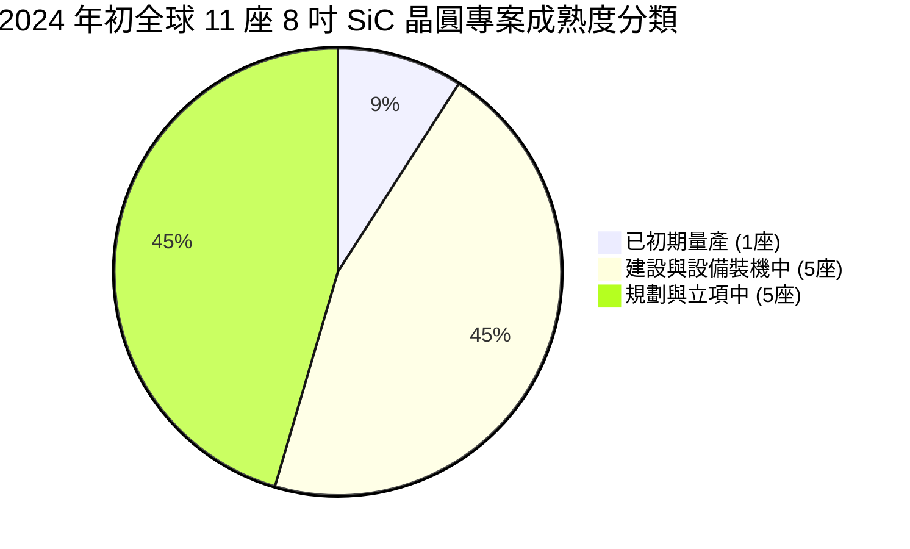

# 8 吋晶圓升級轉型與全球晶圓廠佈局（8-Inch Wafer Transition）

在碳化矽（SiC）產業發展史上，由 **6 吋（150mm）晶圓** 跨越至 **8 吋（200mm）晶圓**，被視為推動元件成本斷崖式下降、加速平價電動車普及的最關鍵轉折點。

> **嚴格時間標記（Temporal Grounding）**：本頁所列之廠房興建與投產狀態，係根據 TrendForce 於 2024 年 3 月所追蹤之全球 11 座 8 吋晶圓廠動態（出處：`SRC-04`）及 Wolfspeed 2024 年年報披露（出處：`SRC-05`）。切勿將 2024 年之產線規劃混淆為已全面達標之既成事實。

---

## 1. 8 吋晶圓之製程經濟學（Scale Economics）

升級至 8 吋晶圓的核心動力在於單位晶粒（Die）成本的巨幅下降：

| 評估維度 | 6 吋晶圓（150mm） | 8 吋晶圓（200mm） | 效益與良率條件分析 |
| :--- | :---: | :---: | :--- |
| **物理晶圓表面積** | 約 $176.7\text{ cm}^2$ | 約 $314.2\text{ cm}^2$ | **表面積增加約 1.78 倍** |
| **單片理論晶粒數（Gross Dies）** | 基準線（1.0x） | **約 1.8 倍** | 邊緣無效晶粒（Edge Exclusion）比例下降 |
| **實際可用良品數（Good Dies）** | 基準成熟良率 | **高度取決於爬坡良率（Yield）** | 初期長晶缺陷與翹曲可能使可用良品大打折扣 |
| **每顆晶粒製造成本** | 基準線 | **成熟良率下預期降 30%～35%** | 初期因高額折舊與低良率反而可能成本偏高 |

由於基板佔元件總成本近五成（[[substrate-and-epitaxy]]），若能以 8 吋規模長晶切片並配合自動化前段製造，將徹底重塑產業競爭維度。

---

## 2. 全球 11 座 8 吋晶圓廠建置狀態分類（截至 2024 年初進展）

### 類別 A：已進入初期量產 / 產能爬坡（Operational / Ramping Up）
1. **[[wolfspeed]]（美國紐約州 Mohawk Valley 晶圓廠）**：
   - 全球首座專用 8 吋自動化 SiC 晶圓廠（2022 年落成）。
   - **實質進展**：截至 2024 年 6 月（FY24 Q4），正式達成 **20% 投片利用率**，目標朝 25% 推進（出處：`SRC-05`）。然而初期閒置成本高達 3.94 億美元，展現良率爬坡的漫長性。

### 類別 B：建設中 / 設備裝機中（Under Construction / Tool Installation）
2. **[[stmicroelectronics]]（義大利 Catania 廠）**：
   - 打造一體化 8 吋 SiC 晶圓與元件製造園區，預計 2024～2025 年啟動設備調試。
3. **ST & 三安光電合資廠（中國重慶）**：
   - 總投資 32 億美元，三安獨資興建配套 8 吋基板廠，合資廠專注 8 吋晶圓代工製造。
4. **[[infineon]]（馬來西亞 Kulim 第三期）**：
   - 投資巨額資金打造全球最大的 8 吋 SiC 功率半導體前段製造工廠之一，2024 年下半年展開首期設備移入。
5. **羅姆 ROHM / SiCrystal（日本宮崎國富廠）**：
   - 收購原 Solar Frontier 廠房進行 8 吋碳化矽產能擴充改裝。
6. **[[onsemi]]（南韓富川 Bucheon 廠）**：
   - 擴充 8 吋晶圓前段加工與先進模組產線。

### 類別 C：規劃中 / 專案立項推動中（Announced / Planned）
7. **Bosch（美國加州 Roseville）**：收購 TSI Semiconductors 後改造為 8 吋碳化矽晶圓廠。
8. **三菱電機 Mitsubishi Electric（日本熊本菊池市）**：規劃投資約 1000 億日圓興建 8 吋新廠。
9. **士蘭微 Silan（中國廈門）**：規劃 8 吋 SiC 晶圓項目。
10. **富士電機 Fuji Electric（日本津輕工廠）**：規劃評估導入 8 吋產線。
11. **其他新興廠商專案**：包括天岳、天科合達等上游基板廠配合之下游代工合作專案。

---

## 3. 邁向 8 吋技術面臨的殘酷現實
- **結晶熱應力劇增**：200mm 直徑的溫場不均勻極易引發晶錠開裂，導致初期晶錠長晶有效長度受限。
- **翹曲度（Warp / Bow）難以達標**：晶圓直徑變大使得應力累積加劇，薄片拋光後翹曲過大會導致前段微影製程（Photolithography）對焦失真。
- **良率爬坡代價高昂**：在良率尚未達到 70%～80% 之前，8 吋晶圓的高額折舊反而可能導致初期單位成本高於成熟的 6 吋產線。

---

## 4. 關聯知識頁面
- 基板與長晶原理：[[substrate-and-epitaxy]]
- 成本結構詳細拆解：[[cost-breakdown-and-manufacturing]]
- 先鋒廠營運挑戰：[[wolfspeed]], [[stmicroelectronics]]
- 未來產能風險：[[challenges-and-risks]]
