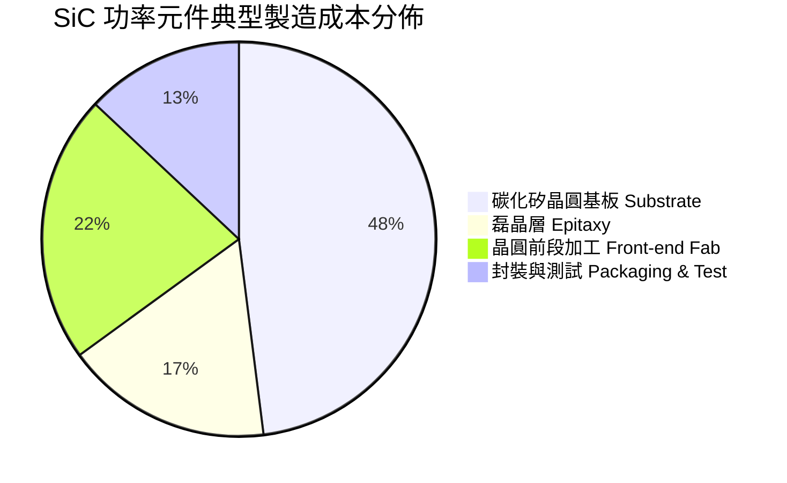

# 碳化矽成本結構拆解與製造經濟學（Cost Breakdown and Manufacturing）

理解碳化矽（SiC）的市場滲透路徑，必須先理解其與傳統矽（Silicon, Si）截然不同的**成本構成邏輯（Cost Structure）**。

---

## 1. SiC vs. Si 成本結構對比

在傳統矽功率半導體（如矽基 IGBT 或低壓 MOSFET）中，矽晶圓基板只佔總成本的 **5%～10%**，其成本主力主要集中於前段高階微影與多次光罩製程。

然而，在碳化矽功率元件中，情況完全相反（出處：`SRC-04`）：

- **基板與磊晶合計佔比超過 65%**：上游材料良率直接主宰了最終晶片成品的售價與毛利率。
- 這也是為何各大半導體 IDM 巨頭（如 [[onsemi]], [[stmicroelectronics]], [[wolfspeed]]）竭盡所能推動材料端垂直整合的原因。

---

## 2. 為什麼碳化矽元件比矽昂貴數倍？

初學者常問：「碳和矽在地殼中極為豐富，為何 SiC 晶片售價仍是傳統 Si 的 2～3 倍以上？」核心製造瓶頸在於：

### 2.1 極端物理條件與龜速長晶
- **溫度與壓力**：矽在 1420°C 熔化成長，設備成熟且長晶速度快（數十公分/小時）；SiC 在常壓下無液相，需在 **2000°C～2400°C** 超高溫封閉石墨坩堝中讓氣體緩慢昇華重結晶（PVT），長晶速度每小時僅約 **0.1～1 毫米**（出處：`SRC-01`）。
- **長度受限**：一個矽單晶棒可長達 2 公尺以上，切出上千片晶圓；一個 SiC 晶錠通常僅能生長 2～5 公分厚度，切出幾十片晶圓。

### 2.2 切片粉末損耗（Kerf Loss）
- SiC 莫氏硬度高達 9.5，切片極為困難且緩慢。
- 採用金剛石線切割時，線鋸本身的直徑與磨料會消耗掉近 **40% 的晶錠厚度**，珍貴的單晶直接化為廢料粉末（出處：`SRC-04`）。

### 2.3 先進高溫封裝要求（Packaging Demands）
- 傳統矽元件工作溫度通常在 125°C～150°C，使用錫鉛或無鉛焊料（Solder）及標準環氧樹脂封裝即可。
- SiC 晶片功率密度極高且結溫可突破 175°C～200°C，傳統焊料在高溫下會產生熱疲勞裂紋：
  - 必須改用 **奈米銀/銅燒結（Silver/Copper Sintering）** 技術，其熔點高達 900°C 以上且熱導率為傳統焊料的 3～5 倍。
  - 需採用氮化矽（$\text{Si}_3\text{N}_4$）高強度陶瓷基板與雙面直接水冷（Direct-Cooled）模組設計，顯著推升了封裝材料成本。

---

## 3. 系統級總體擁有成本（System-level TCO）優勢

儘管單顆 SiC 元件比矽貴，但車廠與系統廠依然爭相採用的關鍵在於 **「系統級總成本平衡（System-level Total Cost of Ownership）」**：

1. **電池成本節省**：逆變器效率提升 5%，對於一台 80 kWh 電池的純電動車，可減少約 4 kWh 的電池配置；以 2024 年動力電池電芯成本約 \$80～\$100/kWh 計算，可直接省下 **\$320～\$400 美元**。
2. **散熱與結構減重**：冷卻散熱器縮小、銅排線束變細，再省下 \$50～\$100 美元。
3. **結論**：SiC 晶片增加的成本（約 \$150～\$200 美元）能完全被電池與周邊材料的縮減所抵消，為整車廠帶來實質淨利。

---

## 4. 關聯知識頁面
- 長晶技術細節：[[substrate-and-epitaxy]]
- 8 吋成本槓桿：[[8-inch-wafer-transition]]
- 終端車廠價值：[[ev-and-automotive-demand]]
- 企業成本披露：[[wolfspeed]]
